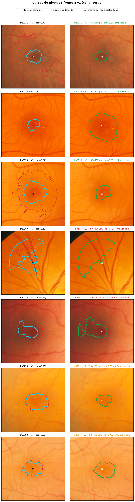

# macula-dmre

**Localización de la fóvea y de la región macular en retinografías mediante curvas de nivel.**

> **English summary.** A classical (non-deep-learning) pipeline that locates the macula and fovea in colour fundus photographs. It segments the retinal vessels, estimates the macular boundary by ray-casting on the vascular network, takes the minimum-intensity point as the macular centre, and then traces radial iso-intensity level curves from it. Version 2 adds vessel suppression, a direction-free radial profile (72 rays), a Gaussian model of the foveal depression with a half-depth contour, and a per-image confidence score. Developed on 7 STARE images and **not yet validated against annotated fovea positions**. Code and comments are in Spanish.

Este código es parte de una línea de investigación sobre degeneración macular relacionada con la edad (DMRE). Su punto de partida es la tesis de pregrado del autor en Ingeniería en Automatización (Universidad de La Salle, Tesis Meritoria).



## Qué hace

| Paso | Archivo | Qué hace |
|---|---|---|
| 0 | `dmre.py` | Máscara del campo de visión y normalización (CLAHE sobre luminancia) |
| — | `dmre.py` | Disco óptico (zona más brillante) y estimación inicial del centro macular |
| 1–4 | `dmre.py` | Segmentación de vasos por zonas, postprocesado, esqueleto y puntos clave |
| 5–7 | `dmre.py` | Contorno macular: rayos cada 10° hasta el primer vaso, ajuste a extremos del esqueleto y contorno suavizado |
| 8–9 | `macula_min_intensity.py` | Área macular del paso 7 y centro por mínima intensidad |
| 10 | `macula_level_curves.py` | Curvas de nivel radiales desde el centro, función radial por una recta horizontal y codo de cambio de pendiente |
| — | `experiment_contours.py` | Comparación entre imágenes: contorno C2, contorno del codo y contorno más circular |
| 10 v2 | `macula_level_curves_v2.py` | Versión robusta del paso 10 (ver abajo) |

### Curvas de nivel v2

`macula_level_curves_v2.py` no modifica la versión 1 y agrega:

- **Supresión de vasos.** Un cierre morfológico en gris rellena los vasos (oscuros y delgados) y conserva la depresión foveal (ancha), así que las curvas dejan de fugarse por los vasos.
- **Centro robusto.** Es el mínimo de la imagen sin vasos y suavizada, no un solo píxel.
- **Perfil radial sin dirección preferente.** Mediana de 72 rayos y perfil área–nivel.
- **Modelo de la depresión foveal.** `I(r) = B + c·r − D·exp(−r²/2σ²)`, que da la profundidad `D`, el ancho `σ` y el radio a media profundidad `r50`.
- **Contorno de media profundidad.** Es la curva de nivel con nivel `I(r50)`.
- **Confianza alta, media o baja.** Sale del R² del ajuste, la consistencia entre 8 sectores, la forma del contorno y la posición del centro.
- **Escala física aproximada.** Usa el campo de la cámara y 288 µm por grado.

Resultados, ablación y limitaciones: [`AVANCES_curvas_de_nivel_v2.md`](AVANCES_curvas_de_nivel_v2.md).

## Uso

Requiere Python 3.9–3.12.

```bash
python3 -m venv .venv
source .venv/bin/activate          # Windows: .venv\Scripts\activate
pip install -r requirements.txt

python3 dmre.py --input im0299.ppm                 # pasos 0–7
python3 macula_level_curves.py                     # paso 10 (v1), todas las imágenes → results/
python3 experiment_contours.py                     # comparación entre imágenes → results_experiment/
python3 macula_level_curves_v2.py                  # paso 10 (v2) → results_v2/
python3 macula_level_curves_v2.py --vessel_kernel 0 --output_dir results_v2/ablacion_sin_vasos
```

Opciones de `macula_level_curves_v2.py`: `--input`, `--input_dir`, `--output_dir`, `--channel {green,luminance}`, `--fov_deg` (campo de la cámara en grados; STARE: 35) y `--vessel_kernel` (diámetro del cierre en px; 0 = sin supresión).

## Estado

- Desarrollado y probado con 7 imágenes de STARE. Sirven para desarrollo, no como evidencia cuantitativa.
- Aún no se ha medido el error contra fóvea anotada. Ese es el siguiente paso, con IDRiD, ADAM o REFUGE.
- La escala física es aproximada. Se reemplazará por la normalización con el diámetro del disco óptico.

## Datos

Las imágenes `im*.ppm` son del proyecto **STARE (STructured Analysis of the Retina)**: TopCon TRV-50, campo de 35°, 700 × 605 px. Página del proyecto: https://cecas.clemson.edu/~ahoover/stare/

Si usas estas imágenes, cita:

> A. Hoover, V. Kouznetsova y M. Goldbaum, "Locating blood vessels in retinal images by piecewise threshold probing of a matched filter response", *IEEE Transactions on Medical Imaging*, vol. 19, n.º 3, pp. 203–210, 2000.

## Publicación relacionada

> "Macular Segmentation Using an Automatic Deep Learning and Graph Cut Strategy", en *Applied Computer Sciences in Engineering* (WEA 2026), *Communications in Computer and Information Science*, vol. 3182, pp. 92–104. Springer, 2026. https://doi.org/10.1007/978-3-032-41324-6_8

Ese capítulo segmenta la mácula con deep learning y graph cut. Este repositorio sigue una vía clásica complementaria, basada en la red vascular y en curvas de nivel.

## Licencia

Código bajo licencia [MIT](LICENSE). Las imágenes de STARE no están cubiertas por esta licencia: pertenecen a sus autores.
